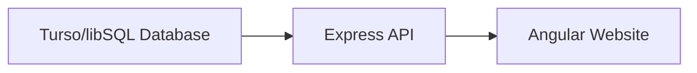
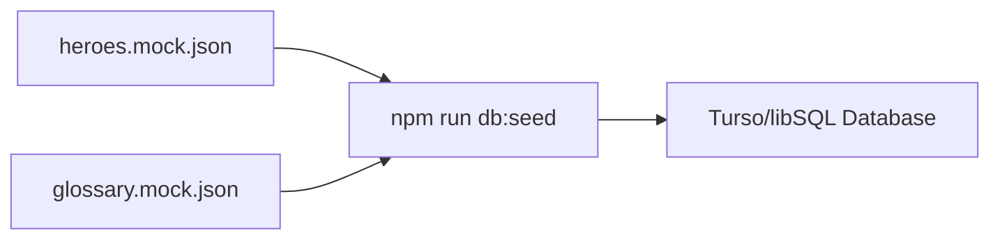
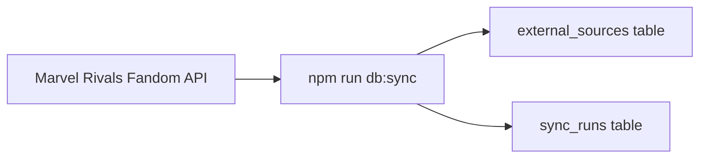
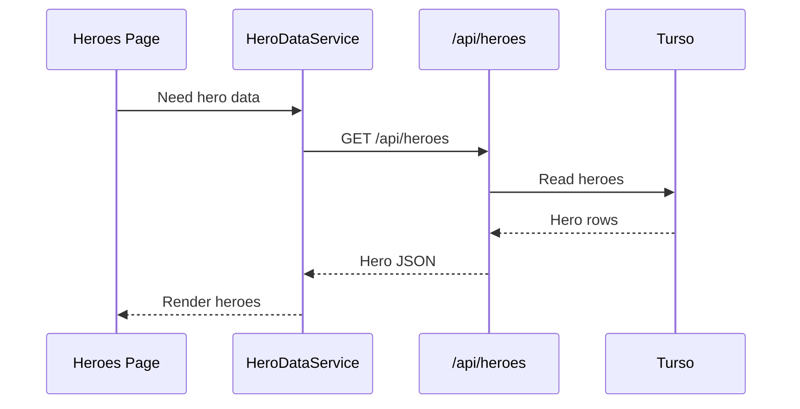
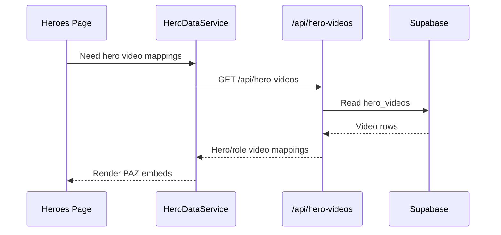
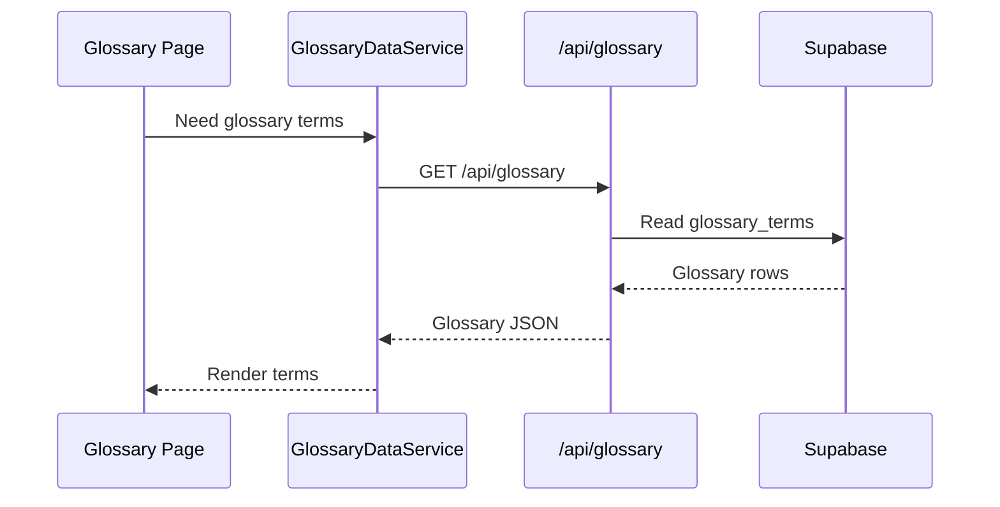
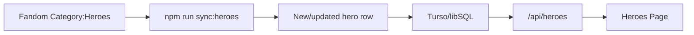
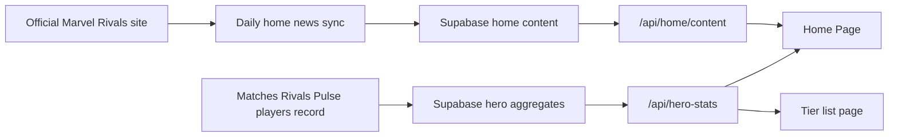
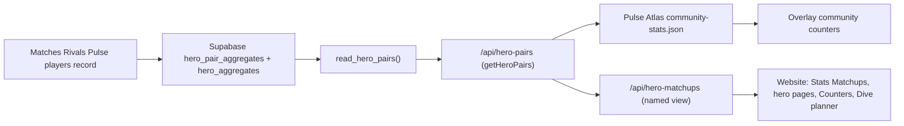

# Content Data Flow

This page explains where the site content comes from, where it is stored, and how the website reads it.

## Short Version

The website should read content from the shared Turso/libSQL database.



That is the main idea.

The JSON files and wiki API calls are used to fill or update the database.

## The Three Jobs

There are three separate jobs in the content system.

| Job | What It Does | Main Files |
| --- | --- | --- |
| Seed | Copies local JSON data into Turso, and the home page seeds into Supabase | `scripts/seed-sqlite.mjs`, `scripts/seed-home-content.mjs` |
| Sync | Fetches outside data from official, stats, and Fandom/wiki sources | `scripts/sync-external-sources.mjs`, `scripts/sync-home-news.mjs` |
| Hero Sync | Finds current Fandom heroes and updates the heroes in Supabase | `scripts/sync-heroes.mjs` |
| Read | Lets Angular pages get data from Turso | `src/server.ts`, `src/server/content/content-database.ts` |

## 1. Seed Data

Seed data is your starting content.

These files are seed data:

- `data/seeds/heroes.mock.json`
- `data/seeds/glossary.mock.json`

They are not the main runtime source anymore.

When you run:

```bash
npm run db:seed
```

the seed script copies those JSON files into Turso.



After that, the website reads from Turso, not directly from those JSON files.

## 2. Wiki/API Sync

Some data comes from outside sources, like the Marvel Rivals Fandom API.

When you run:

```bash
npm run db:sync
```

the sync script fetches external data and saves the raw response in Supabase.



Right now the sync script stores these external sources:

- `fandom-battlepasses`
- `fandom-deadpool`
- `fandom-deadpool-abilities-template`

The `sync_runs` table keeps a history of whether each update worked or failed.

## 3. Website Reads

When a user opens a page, Angular asks the Express API for content.

For heroes:



For hero videos:



For glossary:



## What Each Piece Means

### Turso Database

The shared content database is configured with:

```text
TURSO_DATABASE_URL
TURSO_AUTH_TOKEN
```

It stores heroes, abilities, glossary terms, and cached external API responses.

### Express API

The Express server exposes database data through routes:

```text
GET /api/heroes
GET /api/hero-videos
GET /api/home/content
GET /api/home/portals
GET /api/glossary
GET /api/external-sources/:sourceKey
GET /api/content/status
```

These routes are defined in:

```text
src/server.ts
```

They read the database through:

```text
src/server/content/content-database.ts
```

`GET /api/content/status` includes `communityHeroStats: { status, halfSeason, inPlaceOf, matchesCounted, heroesPlaced }`,
a summary of the Rivals Pulse hero numbers (`status` is `ready`, `not-enough-data` or `unavailable` when the
aggregates cannot be read; `inPlaceOf` is set while the previous half-season stands in for the current one).
It replaced the old tier-list counts.

### Angular Services

Angular pages should not read Turso directly.

They use services:

```text
HeroDataService -> GET /api/heroes
GlossaryDataService -> GET /api/glossary
```

The services then give the page data to display.

## Update Commands

Use this when you changed local JSON seed files:

```bash
npm run db:seed
```

Use this when you want to refresh external wiki/API data:

```bash
npm run db:sync
```

Use this when new heroes are released or hero pages change:

```bash
npm run sync:heroes
```

Use this when you want to do both:

```bash
npm run content:update
```

`content:update` now runs seed, external sync, and hero sync. The seed no longer touches heroes: they live in Supabase and the hero syncs write them there.

## New Hero Flow

When a new hero appears on Fandom:



If the new hero does not have a local portrait yet, the site uses `default-hero.png` until you add an image.

## Current Status

Already database-backed:

- Heroes page
- Glossary page
- Home page official updates, latest tuning, and events/rewards
- Tier list and the Game News band's season dates, from Rivals Pulse players' matches; and the home hero's matches-counted figure, from the matches the app has seen (`read_game_counts()`, through `/api/community/matches`)



The home page renders only content returned by `/api/home/content` and `/api/hero-stats`; none of
it has a local content fallback. Every hero number on the site is a Rivals Pulse number: no
third-party source is read, and below the minimum sample a page shows "not enough data yet".

`HomePageComponent` stacks the sections as full-width bands (the app shell supplies the page's one `<main>`) and owns the hero
video. Each section wraps itself in the shared `HomeBandComponent`, which renders the band's
`<section>`, h2 and lede, so heading order lives in one place. The page reads the cached
official content through `HomeContentService` (one `/api/home/content` request, shared) and passes
it, as a plain input, to the Game News band:

- `GameNewsBandComponent` is the band that holds every news block, in three columns: the season at a
  glance (with the latest tuning post), the newest hero, the official updates as the patch-notes
  block, the season update spotlight and events. `buildGameNewsView` turns the content into those
  blocks, caps each list at three and collapses a block with nothing to show. The half-season dates
  for the glance come from the hero stats, in the browser only (the end is the next half-season's
  start, otherwise "ongoing"). The spotlight's "Watch update video" button emits `watchVideo`; the
  page, which owns the video, opens its player.
- `CurrentHeroStatsService` (`features/insights`) fetches `/api/hero-stats` once and shares it; a failed read is not kept, so the next ask fetches again. The home page reads it in the browser only, for the news band's dates; the heroes page, the Stats Heroes tab and the Tier list and Win rates pages (default cut only) share the same read. `CurrentHeroMatchupsService` does the same for `/api/hero-matchups`, read by the heroes page, the Stats Matchups tab, the Counters tool and the Dive planner. A half-season or mode the reader picks is read through `HeroStatsService` directly. The matches-counted figure under the hero buttons comes from `CommunityMatchesService` (`/api/community/matches`, shared with the Stats overview), which carries the half-season's matches from `read_game_counts()`, the same number the Stats overview lists for that half-season. The hero's downloads and rating come from
  `OVERWOLF_LISTING_STATS` and read "Coming soon" until the Overwolf listing has them.

That would make the home page use the same database-backed flow as the rest of the site.

## Hero counters: one source

Who counters whom has one primary source: the pair counts the database keeps in `hero_pair_aggregates`
and `hero_aggregates`, read by `public.read_hero_pairs()`. Every reader takes those counts and applies
the same rule to them, so a hero is a counter on the website exactly when it is one in the overlay.



- **The rule** is one: a pair needs 10 decided matches, and it is a counter when its win rate, shrunk by a
  prior estimated from the band's heroes, is at least 3 percentage points above the hero's own shrunk win
  rate. The website's copy is [`hero-pair-edges.ts`](../src/server/heroes/pairs/hero-pair-edges.ts), which
  `/api/hero-matchups` calls once and sends as `isCounter` so no page repeats the threshold; the overlay's is
  `community-stats.dataset.ts`. They are changed together.
- **Pulse Atlas publishes counts only**, so the overlay computes the shrunk rates and edges from the file.
  The website's server computes them from the same counts read live, so the two can differ only by the time
  between the last Atlas publish and now.
- **`/api/hero-matchups` is a view, not a second source.** Its pairs, counts, minimum and half-season are
  the pair counts'. It still reads `read_hero_matchups` for one thing: each pair's KDA and final hits while
  facing the enemy, which the pair counts do not carry (issue 680 tracks publishing them). `/api/hero-switch-ins`
  also still reads `read_hero_matchups` to set a switch-in beside the hero's overall record against that enemy.
- **Personal counters stay personal.** What a player's own matches say lives in the overlay and is never
  blended into these lists.

## Mental Model

Think of it like this:

```text
JSON files and wiki APIs fill Turso.
Turso feeds the API.
The API feeds the Angular pages.
```

Or shorter:

```text
Sources -> Turso -> API -> Website
```
