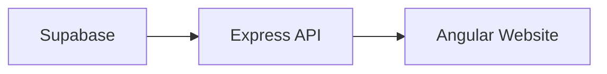
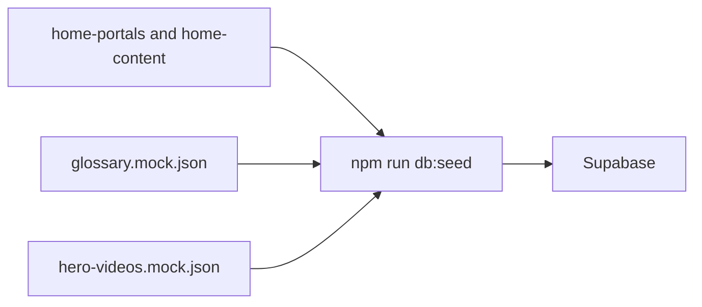
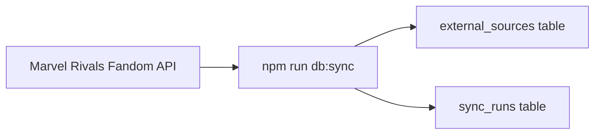
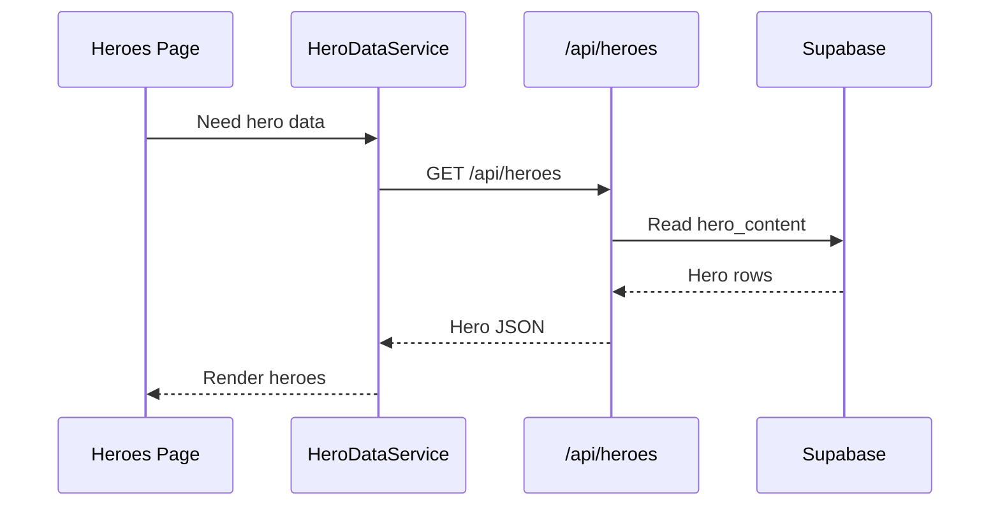
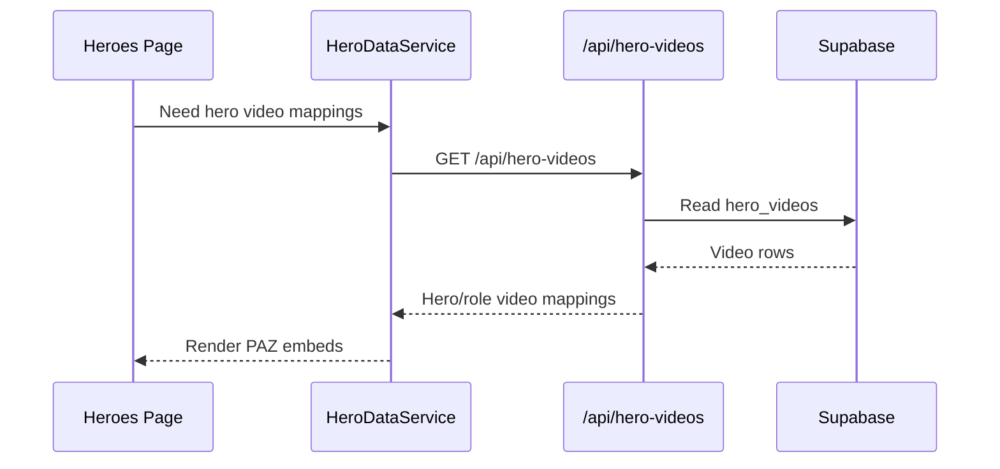
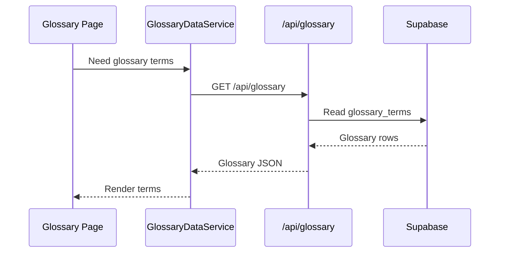
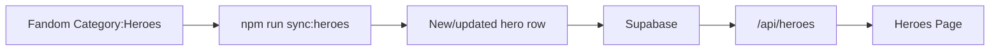
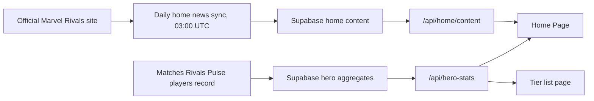

# Content Data Flow

This page explains where the site content comes from, where it is stored, and how the website reads it.

## Short Version

The website reads all of its content from one database, Supabase (hosted Postgres). See
[supabase.md](supabase.md) for its tables.



That is the main idea.

The JSON files and wiki API calls are used to fill or update the database.

## The Four Jobs

There are four separate jobs in the content system.

| Job | What It Does | Main Files |
| --- | --- | --- |
| Seed | Copies the local JSON seed files into Supabase | `scripts/seed-home-content.mjs`, `scripts/sync-glossary.mjs`, `scripts/sync-hero-videos.mjs` |
| Sync | Fetches outside data from official, stats, and Fandom/wiki sources | `scripts/sync-external-sources.mjs`, `scripts/sync-home-news.mjs` |
| Hero Sync | Finds current Fandom heroes and updates the heroes in Supabase | `scripts/sync-heroes.mjs` |
| Read | Lets Angular pages get data from Supabase | `src/server.ts`, `src/content-database.ts` |

## 1. Seed Data

Seed data is your starting content.

These files are seed data:

- `data/seeds/home-portals.mock.json`
- `data/seeds/home-content.mock.json`
- `data/seeds/glossary.mock.json`
- `data/seeds/hero-videos.mock.json`

They are not the main runtime source anymore. Heroes are not seeded: the hero syncs write them.

When you run:

```bash
npm run db:seed
```

the seed scripts copy those JSON files into Supabase.



After that, the website reads from Supabase, not directly from those JSON files.

## 2. Wiki/API Sync

Some data comes from outside sources, like the Marvel Rivals Fandom API.

When you run:

```bash
npm run db:sync
```

the sync script fetches external data and saves the raw response in Supabase.



Right now the sync script stores these external sources:

- `fandom-battlepasses`
- `fandom-deadpool`
- `fandom-deadpool-abilities-template`

The `sync_runs` table keeps a history of whether each update worked or failed.

## 3. Website Reads

When a user opens a page, Angular asks the Express API for content.

For heroes:



For hero videos:



For glossary:



## What Each Piece Means

### Supabase

The content database is Supabase. Server code reaches it with:

```text
SUPABASE_URL
SUPABASE_SERVICE_ROLE_KEY
```

It stores heroes, abilities, home page content, glossary terms, hero videos, game stats, sync runs
and cached external API responses, beside the match data the overlay uploads. See
[supabase.md](supabase.md).

### Express API

The Express server exposes database data through routes:

```text
GET /api/heroes
GET /api/heroes/:id
GET /api/hero-videos
GET /api/home/content
GET /api/home/portals
GET /api/glossary
GET /api/external-sources/:sourceKey
GET /api/content/status
```

These routes are defined in:

```text
src/server.ts
```

They read the database through:

```text
src/content-database.ts
```

`GET /api/content/status` includes `communityHeroStats: { status, halfSeason, inPlaceOf, matchesCounted, heroesPlaced }`,
a summary of the Rivals Pulse hero numbers (`status` is `ready`, `not-enough-data` or `unavailable` when the
aggregates cannot be read; `inPlaceOf` is set while the previous half-season stands in for the current one).
It replaced the old tier-list counts.

### Angular Services

Angular pages should not read the database directly.

They use services:

```text
HeroDataService -> GET /api/heroes
GlossaryDataService -> GET /api/glossary
```

The services then give the page data to display.

## Update Commands

Use this when you changed local JSON seed files:

```bash
npm run db:seed
```

Use this when you want to refresh external wiki/API data:

```bash
npm run db:sync
```

Use this when new heroes are released or hero pages change:

```bash
npm run sync:heroes
```

Use this when you want to do both:

```bash
npm run content:update
```

`content:update` now runs seed, external sync, and hero sync. The seed no longer touches heroes: they live in Supabase and the hero syncs write them there.

## New Hero Flow

When a new hero appears on Fandom:



If the new hero does not have a local portrait yet, the site uses `default-hero.png` until you add an image.

## Current Status

Already database-backed:

- Heroes page
- Glossary page
- Home page official updates, latest tuning, and events/rewards
- Tier list, the home hero stats snapshot and the season glance dates, from Rivals Pulse players' matches



The hero stats snapshot, the season dashboard and the season glance render only content returned by
`/api/home/content` and `/api/hero-stats`; none contains local content fallbacks. Every hero number on the site is a
Rivals Pulse number: no third-party source is read, and below the minimum sample a page shows
"not enough data yet". `SeasonGlanceService` composes the cached official content with the
half-season dates for the glance component (the end is the next half-season's start, otherwise
"ongoing"), while `SeasonDashboardService` passes the cached official content to the dashboard
component. `StatsSnapshotComponent` reads the hero stats through `HomeHeroStatsService`, which
fetches `/api/hero-stats` once for the hero trust line, the glance and the snapshot together, and
the hero list for roles and portraits, in the browser only. `HomePageComponent` only composes those
components and owns video behavior.

That would make the home page use the same database-backed flow as the rest of the site.

## Mental Model

Think of it like this:

```text
JSON files and wiki APIs fill Supabase.
Supabase feeds the API.
The API feeds the Angular pages.
```

Or shorter:

```text
Sources -> Supabase -> API -> Website
```
