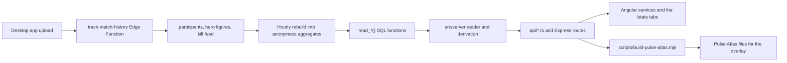

# Hero System

How the community's hero numbers get from an uploaded match to the Stats hub:
win rates, pick rates, tiers, per-minute figures, counters, team comps and the
counts behind them. Which function owns each figure, and which tab shows it, is
recorded in [ADR-0008](decisions/0008-give-each-stat-one-read-and-one-home.md);
this page is the walk-through, and it was checked against the code on
2026-11-11 (rule 20). When the two disagree, the code wins: fix this page.

The hero reference content (profiles, abilities and the roster) is a separate
flow: `hero_content` in Supabase, served by `GET /api/heroes`, with the roles
the stats pool by. See [content-data-flow.md](content-data-flow.md).

Hero kit Mobility, its table and its formula: [hero-kit-mobility.md](hero-kit-mobility.md).

The 1 to 10 build scores from real matches, and how every ability is tagged: [hero-build-scores.md](hero-build-scores.md).

## The flow

1. **Upload.** The desktop app posts a finished match to the
   `track-match-history` Edge Function
   ([`supabase/functions/track-match-history/index.ts`](../supabase/functions/track-match-history/index.ts)).
   It checks the Overwolf session, limits one user to 30 uploads an hour, and
   stores the match through `record_match_participants` (one row per scoreboard
   line). An upload that carries the optional extra fields also calls
   `record_match_extras` (the recorder's own damage, healing, damage blocked
   and time per hero, and the kill feed), `record_match_ability_uses` and
   `record_match_hero_timelines`. A **match** is its roster fingerprint plus its
   start time, so two players recording one match store it once. Fields and
   limits: "Extended upload" in [supabase.md](supabase.md).
2. **Aggregate.** Raw rows are deleted once the next half-season has ended, so
   anonymous counts (no uid, name or fingerprint) are rebuilt from them by
   hourly `pg_cron` jobs, one family per job: `recompute-hero-aggregates`
   (hero lines, totals, hero against enemy), `recompute-extended-aggregates`
   (per-minute figures, kill feed, ability counts), `recompute-hero-pair-aggregates`,
   `recompute-triple-support-aggregates` (trios and line-up shapes),
   `recompute-hero-switch-in-aggregates`, `recompute-community-match-aggregates`
   and `recompute-play-time-aggregates`.
   `purge_expired_participants()` freezes each half-season before it deletes, so
   a frozen half-season keeps its counts and is never rebuilt. Pulse Records and
   the game counts are the exceptions: they read `participants` directly.
3. **Read.** Each stat has one `public.read_*()` function that returns counts as
   one jsonb value and applies the privacy gate where the gate matters (for
   example `hero_figure_qualifies`). The hero, pair, matchup, trio, line-up
   and switch-in reads are granted to `anon` and `service_role` and are called
   with the publishable key; the community, game-count and records reads are for
   `service_role` alone.
4. **Derive.** A reader under `src/server/` calls the function (the shared
   `callReadFunction` or `callSupabaseFunction`, which turn a function that is
   not in the database yet into the empty state and every other failure into an
   error), parses the answer and derives every rate in a pure module such as
   [`hero-stats.ts`](../src/server/heroes/stats/hero-stats.ts). A game hero id
   with no mapping in `data/pulse-atlas/hero-game-ids.json` is left out and
   logged (id 0 is "no hero recorded").
5. **Serve.** One Vercel function under `api/` per endpoint, and the same route
   in [`src/server.ts`](../src/server.ts) for local development and SSR.
6. **Show.** Angular services under `src/app/features/insights/`, `community/`, `heroes/`
   and `records/` fetch the endpoint, and the `/stats` tabs draw
   it ([`stats-tabs.ts`](../src/app/features/stats/stats-tabs.ts),
   [`stats.routes.ts`](../src/app/features/stats/stats.routes.ts)).
   `scripts/build-pulse-atlas.mjs` reads the same endpoints to publish the
   overlay's files ([pulse-atlas.md](pulse-atlas.md)).

## Hero stats, step by step

Source of truth: `read_hero_stats()` and
[`hero-stats.ts`](../src/server/heroes/stats/hero-stats.ts), served by
`GET /api/hero-stats`, shown on `/stats/heroes` (a table or a tier list,
`?view=tiers`).

- **Appearances** are a hero's scoreboard lines in matches with a win or a
  loss. A hero on both teams of one match counts twice, so appearances can
  exceed the matches and the pick rate can pass 100.
- **Win rate** is wins over appearances. **Pick rate** is appearances over the
  matches with a result (below).
- **A hero is placed** once it has `HERO_STATS_MIN_MATCHES` (10) appearances
  and `COMMUNITY_BUCKET_MIN_PLAYERS` (2) different recorders. A hero short of
  either is listed in `belowMinimum` with its counts. A half-season frozen
  before recorders were counted places a hero on appearances alone.
- **Shrunk win rate** is the win rate with a prior added: pretend matches at
  the hero's role average (the overall average for a role with fewer than 3
  heroes), sized from the spread of the heroes counted, between 10 and 500
  pretend matches, or 60 at 50% when fewer than 5 heroes are counted
  ([`win-rate-prior.ts`](../src/server/heroes/stats/win-rate-prior.ts), a copy
  of the overlay's).
- **Tier** comes from the shrunk win rate alone: S from 0.62, A from 0.56, B
  from 0.52, C from 0.48, D from 0.44, otherwise F.
- **KDA** is (kills + assists) over deaths from pooled totals, with no deaths
  counted as 1, and is null when no line carried the figures. **Final hits**
  are per line recorded.
- **Modes.** The default blends Quick Match and Competitive. `?mode=` counts one
  mode alone (`quick-match`, `competitive`, `arcade`, `practice`); a value that
  names no mode is the empty state. Unknown mode is never counted. Practice is
  hidden from the pickers while `SHOW_PRACTICE_MODE` is off.
- **Half-seasons.** The newest half-season that has started is shown. While no
  hero in it is placed, the previous half-season is shown and `inPlaceOf` names
  the current one. `?halfSeason=` asks for exactly one, with no fall-back.
- **Ban rate is not collected.** No aggregate holds bans. `/stats/heroes` shows
  "Ban data: Not collected" and the hero page says "Not collected".

## The two counts

The site states two different match counts and keeps them apart
([ADR-0008](decisions/0008-give-each-stat-one-read-and-one-home.md), decision 3).

| Count | Where it comes from | Label |
| --- | --- | --- |
| **Matches counted**: each match once, every mode, with or without a result | `read_game_counts()` through `getGameCounts`; `matchesCountedIn` picks a half-season | `matchesCountedLabel` ("Matches counted · Season 10.5") |
| **Matches with a result**: Quick Match and Competitive (or the one mode chosen) matches that ended in a win or a loss | `read_hero_stats()`, `hero_aggregate_totals.decided_matches` | `decidedMatchesLabel` ("146 matches with a result") |

The naming trap: **`HeroStats.matchesCounted` in `GET /api/hero-stats`, the
Pulse Atlas `tier-list` rank's `matchesCounted`, and `communityHeroStats.matchesCounted`
in `GET /api/content/status` mean "matches with a result"**, and Atlas
`hero-stats.json` calls the same number `decidedMatches`. The `matchesCounted`
of `GET /api/community/matches` is the other count. A page never uses the word
"counted" for the first one.

## Counters and team comps

- **Counters.** Pair counts come from `read_hero_pairs()` through `getHeroPairs`
  (`GET /api/hero-pairs`, published as `community-stats.json`).
  `GET /api/hero-matchups` is a named view of the same counts, with each
  pair's KDA and final hits added from `read_hero_matchups()`, which never
  decides which pair is listed. A hero counters an enemy when its shrunk win rate
  against that enemy is at least `COUNTER_MIN_EDGE_POINTS` (3) points above its
  own shrunk win rate over at least 10 decided matches
  ([`hero-pair-edges.ts`](../src/server/heroes/pairs/hero-pair-edges.ts)). The
  overlay applies the same rule to the Atlas file, so a hero is a counter in
  both places or neither. The server sends `edge` and `isCounter`; pages do not
  repeat the threshold. Detail: "Hero counters: one source" in
  [content-data-flow.md](content-data-flow.md). Shown on `/stats/matchups`, the
  hero pages, the Counters tool and the Dive planner.
- **Kill feed.** Seen kills per killer and victim from
  `read_community_kill_feed()`, shown on `/stats/matchups`. It is what a
  recorder's own client saw, so it is a different measure from the counters,
  and a pair carries a volume band ("25+ seen kills"), never an exact count.
- **Team comps** on `/stats/team-comps`: best duos (`getHeroSynergies`, the
  `with` pairs of `read_hero_pairs()`), triple-support trios
  (`read_triple_support_trios()`) and line-up shapes
  (`read_team_lineup_shapes()`, published as `team-lineups.json`). They read
  their half-seasons from the same `read_hero_stats()` answer as the hero
  stats, so every tab shows the same current half-season.

## Per-minute figures and roles

- **Damage, healing and damage blocked per minute** come from
  `read_community_hero_figures()` through `getCommunityFigures`
  (`GET /api/community/figures`), pooled as sum times 60 over seconds, never an
  average of rates, and shown at the top of `/stats/heroes` by hero and on `/stats/roles` by role. A figure is
  published once `hero_figure_qualifies` passes in the database (10 matches
  and 2 players), and describes the players who upload, not the lobby.
- **Role averages** pool the per-hero `read_hero_stats()` counts (win rate,
  kills, deaths, assists, KDA and final hits) by role in `getRoleStats`
  (`GET /api/community/stats`) and show on `/stats/roles`, at 50 decided lines
  per role and mode.

- **Map win rates** come from `read_community_matches()` through `getCommunityMatches`
  (`GET /api/community/matches`): Quick Match and Competitive blended, from the
  recorder's side, shrunk toward the average of the maps, and listed on
  `/stats/maps` (every map, the best and worst three, and the known maps still
  waiting for a rate). The Overview shows the best and worst three and a link.

## Not built yet

- **Hero stats in Pulse Atlas** carry win rate, pick rate, KDA and final hits per
  hero. Per-pair KDA and final hits are not published yet (issue 680).

## When a read is empty

A function that is not in the database yet (migration not applied) is the
designed empty state: HTTP 200 with `status: "not-enough-data"` and an empty
list. Any other failure (a refused key, a timeout, a missing variable) is an
error status, so an outage is never shown as "not enough data".
